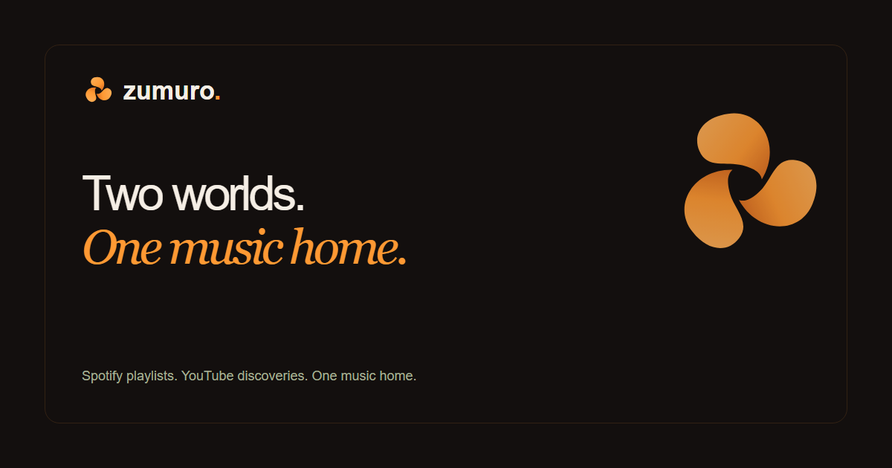
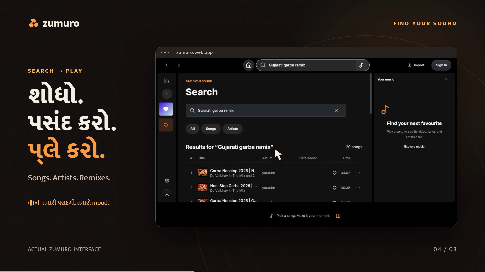
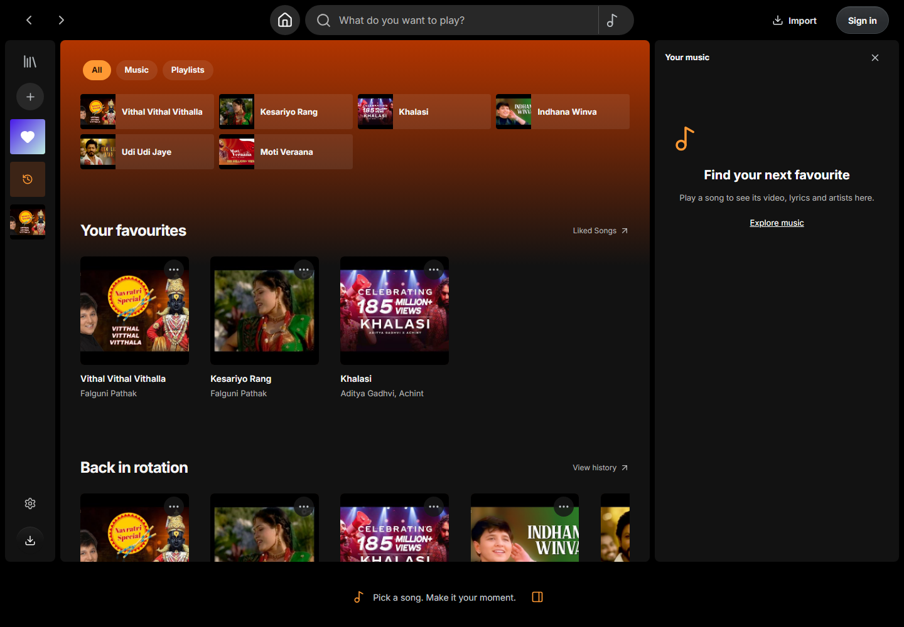
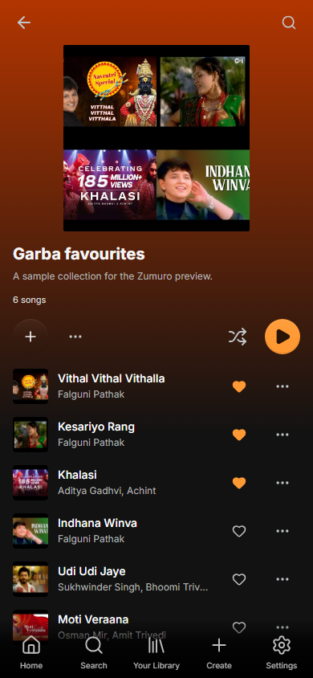
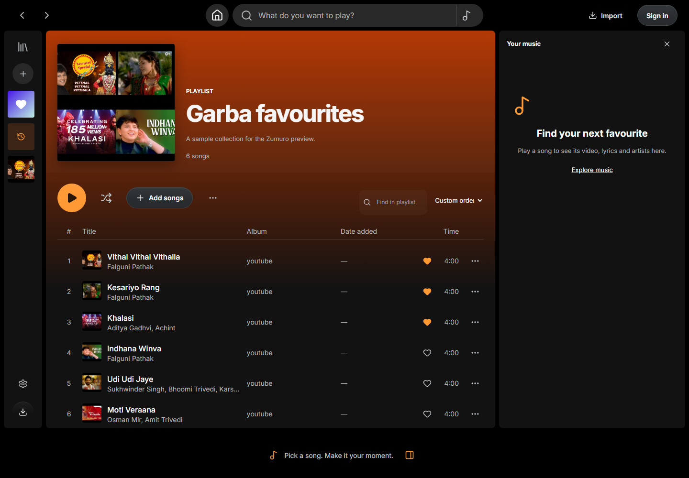
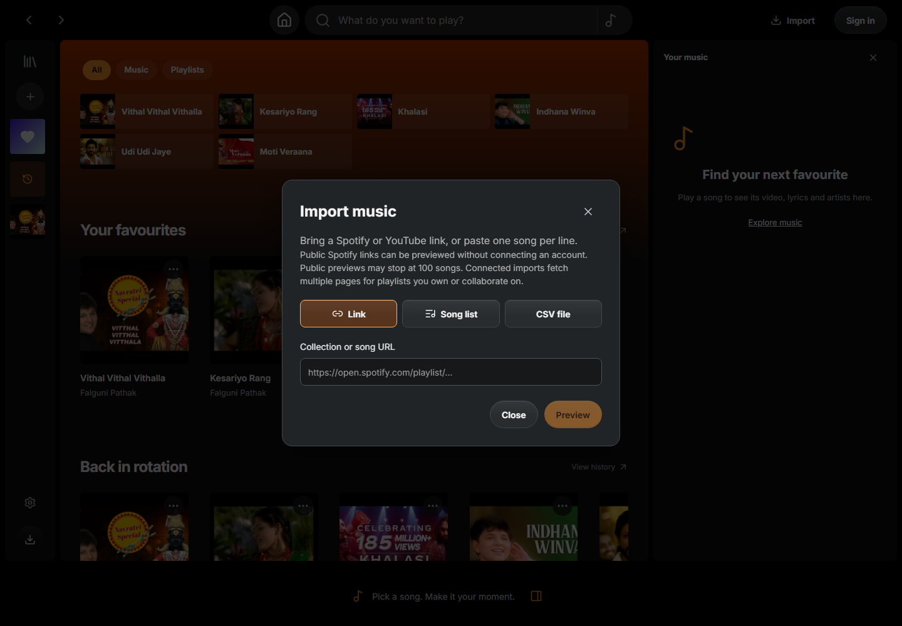

<strong>Your Spotify playlists. Your YouTube discoveries. Your own music home.</strong>

<a href="#watch-zumuro">Watch the film</a> · <a href="#what-you-can-do">Features</a> · <a href="#get-zumuro">Downloads</a> · <a href="https://github.com/krishivsurti/zumuro/discussions">Community</a> · <a href="https://github.com/krishivsurti/zumuro/issues/new/choose">Feedback</a>

> **Official product showcase and community repository.** Zumuro is proprietary software. Its application source code, backend, Firebase configuration and signing keys are not distributed here. Downloading or cloning this repository provides only public showcase materials.

## A little less switching. A lot more listening.

Zumuro brings playlist imports, music discovery and your personal library into one saffron-themed player. Bring a supported Spotify or YouTube playlist, import a song-list CSV, or build a collection from scratch. Search, save favourites and keep your signed-in library with you across the web and Android.

**Zumuro adds no ad breaks. Free accounts have unlimited Zumuro skips.** Guest listening is a limited preview. Availability and any provider-side advertising or restrictions remain controlled by the underlying provider.

## Watch Zumuro

<a href="https://krishivsurti.github.io/zumuro/#film"><strong>▶ Watch the launch film · 44 seconds · Gujarati</strong></a> Original creator-supplied film. Some footage reflects an earlier launch interface.

## One interface, wherever you listen

<table><tr>
<td width="72%"></td>
<td width="28%"></td>
</tr></table>

<strong>Explore playlists and imports</strong>

Screenshots use sample guest collections, not a person's private account data.

## What you can do

| Bring your music | Make it yours | Keep listening |
| --- | --- | --- |
| Import supported Spotify playlists | Create and manage playlists | Playlist autoplay, shuffle and repeat |
| Import supported YouTube collections | Like songs and build your library | A queue you control |
| Upload CSV files or paste song lists | Search and select available recordings | Android background playback |
| Review matches before saving | Sync a signed-in library across devices | Notification and lock-screen controls |

- **A familiar home:** recent listening, favourites and discovery collections together.
- **Your queue first:** manually added songs take priority over automatic suggestions.
- **More choice:** retry a recording or choose another supported YouTube version when needed.
- **Your sound and appearance:** Classic Saffron, appearance choices and supported audio preferences.
- **Privacy controls:** listening-history controls and a reset for device-local autoplay learning.

Imports and recommendations depend on available provider metadata. Exact recordings, tempo matches and universal availability are not guaranteed.

## Get Zumuro

| Platform | Status | Start listening |
| --- | --- | --- |
| Browser | Available | [Open the web player](https://zumuro.web.app/app) |
| Android 8.0+ | Available | [Download the official APK](https://github.com/krishivsurti/zumuro-downloads/releases/latest) |
| Windows desktop | Coming soon | Use the browser player for now |

Official Android binaries are published in [zumuro-downloads](https://github.com/krishivsurti/zumuro-downloads/releases). Install signed updates over your existing official app. This showcase does not contain application source archives or developer builds.

## Three ways to start

1. Open **Import**, choose Spotify, YouTube or CSV/song list, and review the matches.
2. Search for a song, select a recording and make the queue your own.
3. Create a playlist and sign in to sync your library across devices.

## Talk with us and help improve Zumuro

You do not need access to source code to contribute:

- [Report a reproducible bug](https://github.com/krishivsurti/zumuro/issues/new/choose).
- [Suggest a feature](https://github.com/krishivsurti/zumuro/issues/new/choose).
- [Start a community discussion](https://github.com/krishivsurti/zumuro/discussions).
- Share usability feedback, accessibility observations or translation suggestions.
- Propose a collaboration by opening a discussion without posting private information.

See [Contributing](CONTRIBUTING.md). For security concerns, use [private reporting](SECURITY.md), not a public issue.

## What's next

- [x] Web player and Classic Saffron launch experience
- [x] Spotify, YouTube and CSV/song-list import flows
- [x] Signed-in library synchronization
- [x] Android background playback and media controls
- [ ] Continued playback and recommendation improvements
- [ ] Broader physical-device and Bluetooth compatibility testing
- [ ] Windows desktop application

These are directions, not release-date promises.

## Questions you might have

**Is Zumuro open source?**

No. This is a public showcase, feedback and download hub. The application implementation is private, and no open-source license is granted for it.

**Do I need an API key to use it?**

No key is needed to use the hosted web player or official APK.

**Does a Spotify import play Spotify audio?**

No. Imports bring supported playlist metadata into Zumuro; playback uses available supported recordings. Review the matches.

**Will every YouTube upload play?**

No. Owners can disable embedding, and recordings may be removed or region-restricted. Select an available version when necessary.

**Does Android play in the background?**

Background playback and media controls are supported. Provider availability, Android power management and device behaviour still matter. Closing the app completely ends its playback session.

**Is my library public?**

No. Signed-in library access is scoped to your account. Guest collections use local device storage. See [Privacy](PRIVACY.md).

**Is Zumuro affiliated with Spotify or YouTube?**

No. Zumuro is independent. Provider names, content and trademarks belong to their respective owners.

---

Maintained by [@krishivsurti](https://github.com/krishivsurti). [Privacy](PRIVACY.md) · [Security](SECURITY.md) · [Community conduct](CODE_OF_CONDUCT.md) · [Copyright](LICENSE)
